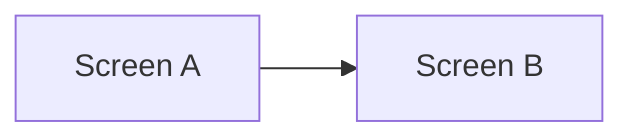

# Design: <Feature name>

## 1. Screens and flow

## 2. Screens
| Screen | Purpose | Primary action |
|---|---|---|

## 3. Components
| Component | Props | States (loading / empty / error / ready) |
|---|---|---|

## 4. Data needs
| Screen | Data | Source (table or API) |
|---|---|---|

## 5. Accessibility and responsiveness
Keyboard use, labels, contrast, and mobile behavior.

## 6. Open questions
| Question | Owner |
|---|---|
