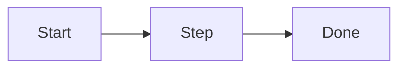

# PRD: <Feature name>

## 1. Problem
Who has the problem, what happens today, why it matters.

## 2. Users
| User | Need |
|---|---|

## 3. Goals and non-goals
**Goals**
- G1

**Non-goals**
- NG1

## 4. Requirements
| ID | Requirement | Priority (must / should / could) |
|---|---|---|
| R1 | | must |

## 5. User flow

## 6. Success measures
| Measure | Target | How it is measured |
|---|---|---|

## 7. Assumptions and risks
| Item | Type (assumption / risk) | Mitigation |
|---|---|---|

## 8. Open questions
| Question | Owner | Needed by |
|---|---|---|
