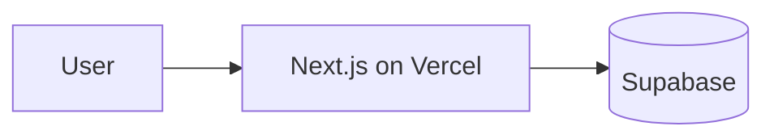
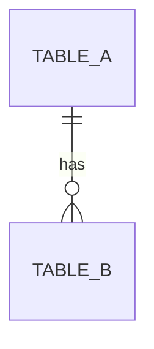

# TSD: <Feature name>

## 1. Summary
One paragraph: the shape of the solution.

## 2. Architecture

| Component | Responsibility | Boundary |
|---|---|---|

## 3. Data model
Tables, columns, relations, and row level security policies. Proposals only; migrations are written by Builder.

## 4. Interfaces
| Interface | Method / path or function | Input | Output | Errors |
|---|---|---|---|---|

## 5. Options and trade-offs
| Option | Complexity | Coupling | Operational cost | Reversibility |
|---|---|---|---|---|

**Recommendation:** <option and why>

## 6. Security and privacy
Authentication, authorization (RLS), secrets, personal data, abuse cases.

## 7. Requirement traceability
| PRD requirement | TSD section |
|---|---|
| R1 | |

## 8. Rollout and rollback
How it reaches `develop`, then `production`. How it is undone.

## 9. Test strategy
| Level | What is covered |
|---|---|

## 10. Open questions
| Question | Owner | Needed by |
|---|---|---|
